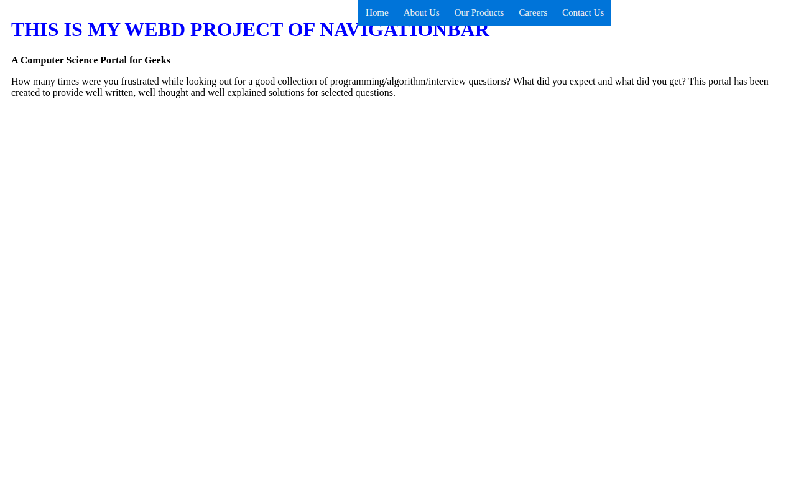

# Slide-Down Navigation Bar on Scroll

A navigation bar that stays hidden above the screen and slides down into view when you scroll down the page — and slides back up when you return to the top.


## Screenshot



## Features

- Fixed navigation bar (Home, About Us, Our Products, Careers, Contact Us)
- Slides down smoothly (0.3s transition) once you scroll past 20px
- Slides back up when you scroll to the top
- Hover effect on nav links

## Tech Stack

- HTML
- CSS
- JavaScript (single self-contained file)

## How to Run

Just open `index.html` in any browser and scroll down — the navbar slides in. No build step, no server needed.

```bash
# or serve it locally
python3 -m http.server
# then open http://localhost:8000
```

## Notes

A small scroll-interaction demo: the page body is mostly placeholder text so there is plenty of room to scroll and watch the navbar behaviour.
